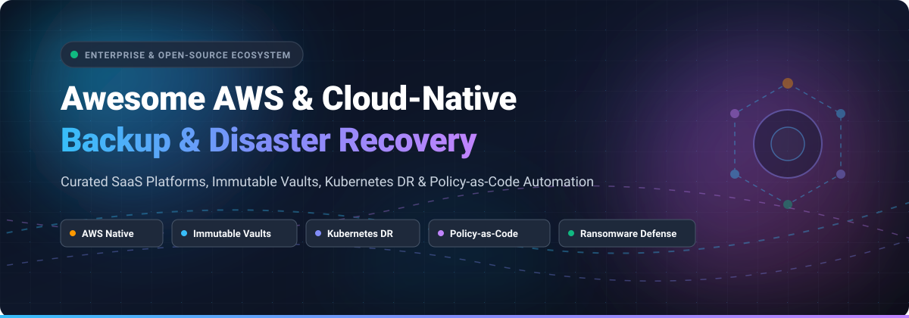

  

# 🛡️ Awesome AWS & Public Cloud-Native Backup Solutions ☁️

  
  
  
  
  
  

> 🚀 A curated list of enterprise SaaS platforms and open-source GitHub projects for AWS, Azure, Google Cloud (GCP), and multi-cloud data protection, immutable cyber-recovery vaults, Kubernetes disaster recovery, and policy-as-code automation.

---

## 📌 Overview

Welcome to the **Awesome AWS & Public Cloud-Native Backup Ecosystem**! 🌐 Protecting modern cloud workloads requires automated snapshot orchestration, ransomware-proof immutable vaults (WORM/S3 Object Lock 🔒), zero-RPO database replication ⚡, and application-consistent Kubernetes data management ☸️.

This guide indexes:
- 🏢 **Enterprise SaaS Platforms**: Scalable, managed backup-as-a-service (BaaS) and disaster-recovery-as-a-service (DRaaS) across AWS EC2, S3, RDS, DynamoDB, Microsoft 365, and SaaS suites.
- 💻 **Open-Source GitHub Tools**: Self-hosted CLI utilities, Terraform modules, and CNCF Kubernetes operators for engineers who build transparent, vendor-neutral backup pipelines.

*📅 Last updated: March 2026*

🤝 Contributions welcome! Open a PR to add/update entries. Keep descriptions factual and link to official sites.

## 📑 Table of Contents
- [📊 Sector Overview & Market Dynamics](#-sector-overview--market-dynamics)
- [🏢 SaaS/Hosted Platforms](#-saashosted-platforms)
- [💻 Open-Source GitHub Projects](#-open-source-github-projects)
- [🤝 How to Contribute](#-how-to-contribute)
- [💖 Support & Sponsorship](#-support--sponsorship)
- [⭐ Star History](#-star-history)
- [⚠️ Disclaimer](#️-disclaimer)

## 📊 Sector Overview & Market Dynamics

The global cloud backup and data protection market is estimated at **$7.1B to $8.7B in 2026** 📈 (scaling to over **$190B+** across the wider data protection and cybersecurity sector at an 11%–24% CAGR). The market is **moderately fragmented and rapidly consolidating into platform-centric architectures** rather than a pure winner-take-all environment: while hyperscalers and top enterprise platforms (Dell, Veeam, Rubrik, Cohesity-Veritas, Commvault) capture dominant enterprise spend through cross-cloud immutability and cyber-vaulting 🏰, specialized vendors continue to thrive across niche cloud databases, Kubernetes, and SaaS application data protection.

## 🏢 SaaS/Hosted Platforms

| Product | Scale & Valuation / Revenue | Starting Price | Free Tier / Trial Limits | Key Cloud-Native Capabilities |
| :--- | :--- | :--- | :--- | :--- |
| **[Dell PowerProtect Cloud](https://www.dell.com/)** | ~$95.6B Revenue (FY25) / ~$75B-$83B Market Cap | Starts at ~$48/user/year (SaaS apps) or ~$1,500/TB/yr (PowerProtect DDVE capacity tiers) | 90-day free trial (PowerProtect Cloud Snapshot Manager & Data Manager evaluation license) | Enterprise data protection with Cloud Tier recall, Data Domain Virtual Edition (DDVE) deduplication, and AWS/Azure snapshot orchestration. |
| **[Rubrik Cloud Cluster](https://www.rubrik.com/)** | ~$24B-$25B Market Cap / ~$1.3B ARR | Starts at ~$130/BETB/mo (~$1,560/TB/year for Foundation tier; enterprise deals from ~$50k/yr) | Guided sandbox interactive demo & sales-managed POC (no self-serve free forever tier) | Software-defined Rubrik cluster deployable via Terraform (`polaris_aws_cloud_cluster`), elastic S3 storage tiering, RSC lifecycle automation. |
| **[Veeam Backup for AWS & Azure](https://www.veeam.com/)** | ~$15.0B Valuation / ~$2.0B ARR | Starts at $155 - $228/workload/year (Veeam Universal License - VUL 10-packs) | Free forever for up to 10 AWS workloads (EC2/RDS/EFS); full backup & file restore capabilities | Native AWS policy-based automation, Amazon Redshift Serverless and DynamoDB support, immutable S3 object lock repositories. |
| **[Cohesity DataProtect](https://www.cohesity.com/)** | ~$7.0B-$8.0B Valuation / ~$1.5B Revenue (Combined Veritas) | Starts at ~$200 - $500/TB/year (DataProtect as a Service); AWS Marketplace bundles from ~$29,100/yr | 30-day free trial (DataProtect as a Service / DPaaS evaluation) | High-performance snapshot and backup orchestration across AWS EC2, RDS, Redshift, and DynamoDB with near-zero RPO/RTO and WORM storage. |
| **[Commvault Cloud](https://www.commvault.com/)** | ~$6.5B-$7.0B Market Cap / ~$1.03B Revenue (FY25) | Starts at $1.70/user/mo (M365) or ~$58.50/TB/mo (databases & cloud file/object storage) | 30-day free trial (full access to multi-cloud workloads, ransomware detection & recovery) | Unified multi-cloud protection across AWS, Azure, GCP with automatic discovery, cost estimation, and immutable cloud vaults. |
| **[Acronis Cloud Backup](https://www.acronis.com/)** | ~$3.5B-$4.0B Valuation (EQT buyout) / ~$425M Revenue | Starts at ~$2.00/workload/mo (SaaS seats) to ~$20.00/workload/mo (VMs/servers), or per-GB models | 30-day free trial (complete feature access across VMs, cloud servers, and pooled cloud storage quotas) | Unified backup, disaster recovery, and integrated AI-based active ransomware protection for cloud workloads and endpoints. |
| **[Druva Public Cloud Backup](https://www.druva.com/)** | ~$2.0B Valuation (Series H) / ~$200M+ ARR | Starts at $8.00/user/mo (SaaS/Endpoints) or ~$200/TB-mo credit commitment (AWS workloads) | 30-day free trial (extendable up to 60 days upon request, no credit card required) | SaaS data protection for AWS workloads (EC2, RDS, S3, DynamoDB) with global deduplication and air-gapped immutable storage. |
| **[Kasten K10 by Veeam](https://www.kasten.io/)** | Subsidiary of Veeam (~$15.0B Valuation / ~$2.0B ARR) | Starts at $0.26/worker node/hour (AWS Marketplace PAYG) or $2,250/worker node/year | Free forever for up to 5 Kubernetes worker nodes (full enterprise features, community support) | Kubernetes-native backup and DR platform with application auto-discovery, CSI snapshot integration, and multi-cloud mobility across EKS, GKE, AKS. |
| **[Clumio Cloud Backup](https://www.clumio.com/)** | Acquired by Commvault ($6.5B-$7.0B Market Cap) | Starts at $0.025/GiB-mo + $1.50/M objects (S3 Standard) or $0.045/GiB-mo (EC2/EBS) | 14-day free trial (up to 16 AWS regions connected, 30 concurrent backup tasks, no credit card required) | Serverless, air-gapped backup for AWS S3, EC2, EBS, and DynamoDB with rapid petabyte-scale restores (100M S3 objects restored in ~3 hours). |
| **[HYCU R-Cloud (Protégé)](https://www.hycu.com/)** | ~$140M Raised / ~$58M Revenue | Starts at $1.20/user/mo (IAM/Identity), $2.25/user/mo (M365), or $4.00/user/mo (DevOps/GitHub) | 14-day free trial (service fees waived for connected cloud & SaaS workloads; 30-day trial for identity suites) | Multi-cloud and SaaS data protection covering 100+ sources including AWS EC2, S3, RDS, Azure, GCP, and developer toolchains. |
| **[Rewind Cloud Backup](https://rewind.com/)** | ~$80M Raised / ~$10M ARR | Starts at $3.00/user/mo (GitHub/Jira) or $19.00/mo (e-commerce store tier up to 300 orders/mo) | 7-day free trial (full automated backup and on-demand recovery testing) | Cloud-native automated backup for GitHub repos, Jira, Microsoft 365, and SaaS environments with continuous incremental snapshots. |

## 💻 Open-Source GitHub Projects

Curated open-source projects for self-hosted cloud backup automation, Kubernetes data protection, encrypted multi-cloud sync, and disaster recovery validation—sorted by GitHub stars ⭐:

- **[Rclone](https://github.com/rclone/rclone)**   
  "Rsync for cloud storage"—powerful command-line program to sync and back up files and directories to and from AWS S3, Google Cloud Storage, Azure Blob, Backblaze B2, and over 70 cloud storage providers with server-side encryption and multipart uploads.

- **[Restic](https://github.com/restic/restic)**   
  Fast, secure, and efficient backup CLI program providing deduplication, snapshotting, and client-side cryptography targeting AWS S3, MinIO, and other cloud object stores.

- **[Duplicati](https://github.com/duplicati/duplicati)**   
  Cross-platform backup client with web UI and CLI that securely stores encrypted, incremental, compressed backups in AWS S3, Google Cloud, Azure, and standard cloud protocols.

- **[Kopia](https://github.com/kopia/kopia)**   
  Fast and secure open-source backup and restore tool for Windows, macOS, and Linux with end-to-end client-side encryption, content-defined deduplication, and native support for AWS S3 and cloud storage backends.

- **[BorgBackup](https://github.com/borgbackup/borg)**   
  Deduplicating backup program supporting authenticated encryption, compression, and offsite remote backup workflows suitable for self-managed cloud server snapshots.

- **[Velero](https://github.com/vmware-tanzu/velero)**   
  De facto cloud-native Kubernetes backup and restore platform (formerly Heptio Ark) for backing up cluster resources and persistent volumes (EBS/CSI) to AWS S3, cross-cluster migrations, and disaster recovery.

- **[Chaos Mesh](https://github.com/chaos-mesh/chaos-mesh)**   
  Cloud-native chaos engineering platform for Kubernetes to inject faults and automate backup verification and disaster recovery drill validation under simulated outages.

- **[LitmusChaos](https://github.com/litmuschaos/litmus)**   
  Cloud Native Computing Foundation (CNCF) chaos engineering framework enabling SREs to automate disaster recovery resilience testing, stateful volume failovers, and backup validation in Kubernetes.

- **[ReaR (Relax-and-Recover)](https://github.com/rear/rear)**   
  Bare-metal Linux disaster recovery and system migration tool with direct integration for cloud-hosted instances and remote cloud storage targets.

- **[Kanister](https://github.com/kanisterio/kanister)**   
  CNCF sandbox extensible framework for application-level data management on Kubernetes, enabling application-consistent snapshots, database backups, and data restore pipelines to AWS S3.

- **[backup-and-bcp-for-aws](https://github.com/ned-kelly/backup-and-bcp-for-aws)**   
  Lambda-executed scripts for automated backups of core AWS infrastructure services (Route53, EBS, RDS, EFS) into S3 with cross-cloud synchronization into Google Cloud Storage for disaster recovery and business continuity.

- **[terraform-aws-backup](https://github.com/lgallard/terraform-aws-backup)**   
  Battle-tested Terraform module for provisioning AWS Backup plans, lifecycle rules, cross-account/cross-region copies, and centralized policy enforcement across EBS, RDS, DynamoDB, and EFS.

- **[aws-backup-automation](https://github.com/aws-samples/aws-backup-automation)**   
  Official AWS sample repository with CloudFormation templates and Python automation code for deploying centralized, cross-account AWS Backup architectures at enterprise scale.

- **[aws-backup-actions-framework](https://github.com/aws-samples/aws-backup-actions-framework)**   
  Serverless event-driven automation framework triggering notifications, post-backup integrity validation, and automated remediation based on AWS Backup Amazon EventBridge events.

- **[aws-backup-alarms](https://github.com/aws-samples/aws-backup-alarms)**   
  Centralized alerting and notification pipeline alerting on failed backup jobs, missed restore windows, and unauthorized modifications to AWS Organizations backup policies.

- **[terraform-aws-backup (CloudDrove)](https://github.com/clouddrove/terraform-aws-backup)**   
  Modular Terraform blueprint for creating AWS Backup vaults, rules, selection tags, and scheduled snapshot jobs across AWS environments.

## 🤝 How to Contribute

1. Fork the repo 🍴.
2. Add/edit entries in `README.md` (follow existing format) ✍️.
3. Include: name, link, 1–2 sentence description, and whether it's SaaS or open-source 📋.
4. Submit PR with a short explanation 🚀.

Star ⭐ the repo if you find it useful!

## 💖 Support & Sponsorship

Thank you so much for exploring and using this curated ecosystem! 🙌 If you found this repository helpful for your cloud architectures, disaster recovery pipelines, or SRE toolchains, please consider supporting the project:

- ⭐ **Star this repository** on GitHub to help others discover it.
- 🍴 **Fork and contribute** new cloud backup tools, open-source libraries, or SaaS platform updates.
- 📢 **Share with colleagues**, cloud platform engineers, and DevOps communities.
- ☕ **Buy me a coffee / Sponsor**: If you'd like to support ongoing maintenance and future curated open-source projects, you can sponsor through the **[GitHub Sponsors Dashboard](https://github.com/sponsors/ishandutta2007)**. Your support is deeply appreciated! 🌟

## ⭐ Star History

## ⚠️ Disclaimer

- This is a **community-curated** list — not exhaustive and not an endorsement.
- Cloud backup tools must be configured with appropriate retention policies, encryption, and access controls to meet regulatory and business continuity requirements.
- Self-hosted open-source solutions require proper IAM scoping, vault locking, and regular restore testing to maintain recoverability.

---

**Made with ❤️ for cloud platform engineers, SREs, security architects, and developers building resilient cloud data protection.**  
Let's make cloud-native backup more open, automated, and verifiable. 🚀
